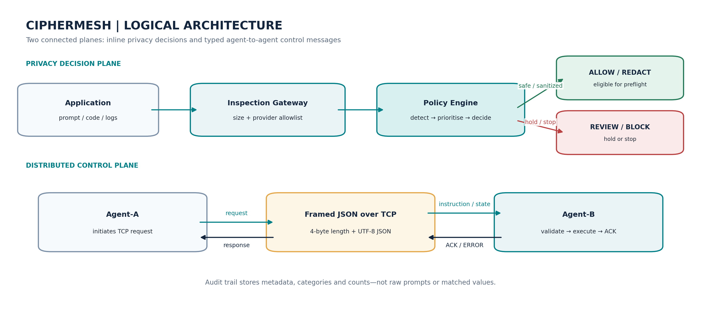
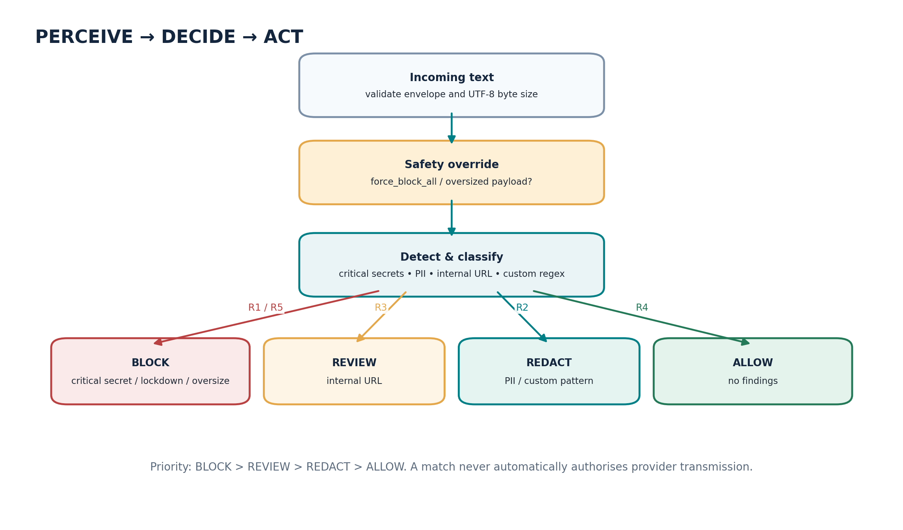
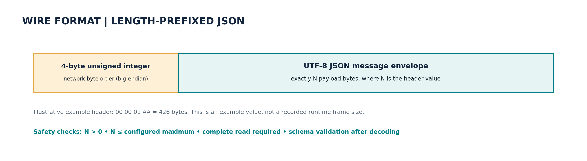
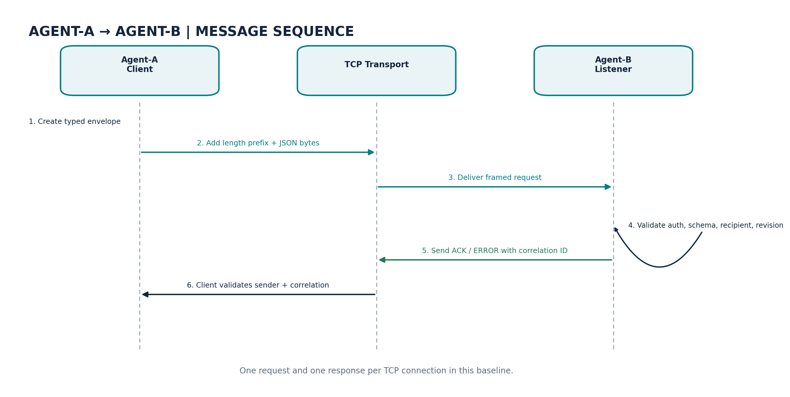

# CipherMesh Multi-Cloud AI Agent
## Distributed Agent Messaging & Privacy Gateway — Implementation Report

**Student:** Kumar Waibhav Akshat  
**Registration ID:** RA2212704010027  
**Programme:** Integrated M.Tech — Computer Science & Engineering (Data Science)  
**Section:** AG1  
**Implementation version:** 0.2.0  
**Prepared:** 12 October 2026

---

## Executive summary

CipherMesh is a local-first prototype of a privacy gateway intended to reduce the risk of sensitive information being copied from developer workflows into large language model (LLM) prompts. Its inspection policy looks for common credential patterns, personal information and internal URLs, then returns one of four decisions: **ALLOW, REDACT, REVIEW or BLOCK**. In addition, the submission implements the requested distributed-agent exercise: Agent-A serializes active policy parameters, sends them across a loopback TCP socket to Agent-B, and receives an acknowledgement after Agent-B validates and applies the approved fields.

The implementation deliberately chooses a simple client-server topology. Agent-B is the listening receiver on TCP port **9052**; Agent-A initiates one request per connection. Messages are UTF-8 JSON inside a four-byte unsigned big-endian length-prefixed frame. This framing is important because TCP is a byte stream, not a message queue: a single read is not guaranteed to return one complete application message. Exact-read loops, frame limits, timeouts, bounded worker concurrency and response correlation checks make the teaching baseline more robust.

Beyond state synchronization, Agent-B acts on three proactive command types: emergency lockdown, validated custom redaction-pattern updates, and a metadata-only telemetry request. It also supports remote text inspection. State updates use a monotonic policy revision and an allow-list of mutable fields; incoming data cannot overwrite Agent-B's identity, local sequence counter or lockdown flag. Audit events contain metadata and finding categories, not raw prompts or matched values.

**Verification performed for this package:** 22 automated tests passed, and a live command-line TCP demonstration passed for PING, STATE_SYNC, email redaction, critical-secret blocking, custom-pattern redaction, telemetry, and emergency lockdown. These results verify the implemented baseline; they do not establish production-grade security, accuracy across all secret formats, or benchmarked throughput.

## Document map

1. Mission, scope and success criteria
2. Domain definition, stakeholder model and PEAS
3. System architecture and trust boundaries
4. Condition-action policy and risk priority
5. Network topology, endpoints and design rationale
6. Serialization and wire protocol
7. State synchronization and validation rules
8. Proactive remote-message handling
9. Codebase walkthrough
10. Setup and dual-terminal execution
11. Demonstration cases and expected outcomes
12. Stability and failure handling
13. Security and privacy analysis
14. Verification and evaluation plan
15. Limitations and next milestones
16. Assignment deliverable mapping
17. References

## 1. Mission, scope and success criteria

### 1.1 Mission

CipherMesh places a provider-neutral inspection boundary between an application and an LLM destination. Its intended role is to detect possible credential, PII and infrastructure disclosure before an application transmits content outside its trust boundary. The distributed messaging layer lets another trusted agent submit a policy snapshot or request a controlled action without allowing arbitrary remote code execution.

### 1.2 Scope included in this build

- Local pattern-based inspection and the ordered ALLOW / REDACT / REVIEW / BLOCK decision policy.
- Provider allow-list check and a preflight gateway function that prepares text only for ALLOW or sanitized REDACT decisions.
- Agent-A command-line client and Agent-B TCP listener.
- Typed Pydantic message schemas, JSON serialization and four-byte length-prefixed framing.
- Validated, revisioned state synchronization.
- Three proactive commands: `TRIGGER_EMERGENCY_LOCKDOWN`, `UPDATE_REDACTION_PATTERNS` and `REQUEST_TELEMETRY_DUMP`.
- Request acknowledgements/errors, correlation validation, bounded replay-ID memory, bounded concurrent workers and socket timeouts.
- SQLite audit logging with metadata only, unit tests, live TCP integration test, and optional FastAPI endpoints.

### 1.3 Explicit non-goals

This version does not invoke AWS Bedrock, Azure AI, Google Vertex AI or Ollama. It does not include mutual TLS, a human-review queue/UI, a signed-policy control plane, multi-host failover, or a benchmark corpus. Those require separate implementation and verification. The term “multi-cloud” describes the target integration domain and provider allow-list, not completed live integrations.

### 1.4 Definition of success

The practical success criterion for the networking assignment is observable: Agent-A sends a typed `STATE_SYNC` message through a real TCP socket; Agent-B deserializes and validates it, applies only permitted policy fields, preserves local-only control fields, records metadata, and sends a correlated `ACK`. Proactive instruction messages must invoke their corresponding handler and return an explicit success or error result.

## 2. Domain definition, stakeholders and PEAS

### 2.1 Problem frame

Developer prompts often contain code fragments, configuration files, stack traces, URLs, logs, or pasted environment output. Such material may inadvertently expose credentials, personal information or internal infrastructure details. OWASP's LLM application risk taxonomy includes Sensitive Information Disclosure and Excessive Agency among the security risks relevant to systems that pass untrusted content into model workflows [1]. CipherMesh addresses a narrow defensive slice of this larger problem: deterministic preflight checks and bounded remote control messaging.

This prototype does not infer user intent perfectly. Pattern detection is evidence for a policy decision, not proof that content is safe. A production system needs broader recognizers, labelled evaluation data and an explicit policy for uncertainty.

### 2.2 Stakeholders

| Stakeholder | Need | CipherMesh contribution |
|---|---|---|
| Developer | Avoid copying secrets into a model request | Preflight findings, sanitization and explicit block/review decisions |
| Application owner | Consistent decision point across model destinations | Provider-neutral `prepare_request` boundary and allow-list |
| Security / privacy team | Observable, auditable policy enforcement | Metadata-only SQLite events and telemetry counters |
| Operations / platform team | Predictable remote policy delivery | Typed message envelope, revisioned state synchronization and explicit acknowledgements |
| Reviewer / instructor | Reproducible network demonstration | Dual-terminal commands and automated loopback TCP test |

### 2.3 PEAS profile

| PEAS element | CipherMesh mapping |
|---|---|
| **Performance measures** | Detection precision/recall on a labelled set, false-block rate, inspection latency, correct action execution, transport success rate, schema rejection correctness, audit privacy |
| **Environment** | Developer tools, local applications, prompt/response content, provider metadata, local network sockets, remote agents, current policy state |
| **Actuators** | Allow unchanged content, redact content, return review-required, block content, apply a validated state revision, activate lockdown, update patterns, return safe telemetry, write audit metadata |
| **Sensors** | Submitted text, provider identifier, message type, sender/recipient, frame length, schema validation result, detector findings and confidence estimates |

### 2.4 Task-environment characteristics

- **Partially observable:** the gateway only sees the supplied content and metadata; it cannot know every external data source, hidden secret or user intent.
- **Stochastic / uncertain:** natural-language ambiguity, novel token formats and regular-expression false positives/negatives make detection imperfect.
- **Sequential:** policy updates, lockdown, prior message IDs and audit state affect future behavior.
- **Dynamic:** new messages arrive at runtime; policy settings and custom patterns may change.
- **Mixed state/action space:** text and latency are continuous-valued, while message types, policy findings and actions are discrete.
- **Multi-agent:** applications, Agent-A, Agent-B, users, and possible provider adapters exchange data across trust boundaries.
- **Partly known:** message schema and configured rules are known; unseen secret formats and intent remain uncertain.

## 3. System architecture and trust boundaries



### 3.1 Privacy decision plane

The inspection path validates the maximum UTF-8 byte size, detects configured sensitive patterns, evaluates policy priority and returns an `InspectionResult`. The provider-neutral preflight layer enforces a key invariant: only ALLOW or sanitized REDACT is marked forwardable; REVIEW and BLOCK return no provider content. There is no model-provider call in the current build, so any future adapter must enforce this invariant immediately before transmission.

### 3.2 Distributed control plane

Agent-A is the initiating client and Agent-B is the listener. The client sends one typed request on a TCP connection and reads one typed response. Agent-B dispatches the message to a handler, executes a narrowly scoped operation, and returns ACK or ERROR. The server is threaded but has a bounded worker count; shared agent state is guarded by a re-entrant lock.

### 3.3 Why client-server rather than P2P for the baseline

The reference proposal describes a dual-role peer-to-peer deployment. This submission intentionally implements the assignment's smaller and more reproducible client-server slice: one receiver and one sender. That choice makes the ownership of state application, listener lifecycle, acknowledgement and error paths unambiguous. It does **not** claim decentralization or eliminate single points of failure. A true P2P deployment would require every node to expose a listener, establish mutual identity, resolve conflicting policy revisions and define leaderless conflict handling.

### 3.4 Endpoint conventions

| Endpoint | Use in this build | Default |
|---|---|---|
| `127.0.0.1:9052` | Agent-B listener for state sync and remote instructions | Implemented |
| `127.0.0.1:9051` | Potential future application ingress port | Reserved / not implemented |
| `127.0.0.1:8000` | Optional local FastAPI service | Optional |

Loopback is appropriate for a single-machine classroom demonstration. Binding to a private network address requires transport encryption, firewalling and identity controls before it is considered safe.

## 4. Condition-action policy and risk priority



The engine applies one deterministic ordering: **BLOCK > REVIEW > REDACT > ALLOW**. Size overflow and emergency lockdown are checked before pattern decisions.

| Rule | Trigger | Result | Enforcement behavior |
|---|---|---|---|
| R1 | AWS-like access key, private-key header, Azure SAS signature or configured generic token pattern | BLOCK | Provider content is `None`; no model call can be made through the preflight result |
| R2 | Email, phone, IPv4, or a configured custom redaction pattern, absent higher-priority findings | REDACT | Matched spans are replaced by category markers; only sanitized text is eligible for forwarding |
| R3 | Internal/corporate URL, absent critical secret | REVIEW | Preflight returns no provider content; human review is still required |
| R4 | No policy-triggering finding | ALLOW | Original content is eligible for forwarding only through a future adapter enforcing the preflight result |
| R5 | Text exceeds the configured UTF-8 byte limit | BLOCK | Request is stopped before pattern matching |
| Emergency | Remote `TRIGGER_EMERGENCY_LOCKDOWN` has set force-block-all | BLOCK | All inspected content is blocked until an authorized local/operator reset is added in a future version |

### 4.1 Data minimization

Findings contain category, offsets, confidence and source, but not the matched value. Redaction uses offsets against the original in-memory string, working backward so earlier offsets remain valid. Audit events store categories, count, decision, reason and elapsed time only. The sanitized text is available only in the immediate inspection response; it is not written into SQLite.

### 4.2 Detector limitations

The detector is an intentionally simple offline baseline. It catches several example patterns but cannot guarantee discovery of every provider credential, encoded secret, obfuscated string, multilingual PII or secret split across multiple requests. Telephone detection is especially prone to false positives. Microsoft Presidio provides a broader recognizer/anonymizer approach and is a candidate future integration, but its NLP stack is **not** invoked by the current detector [4].

## 5. Network topology and design rationale

### 5.1 Raw TCP selected for the assessed path

Raw TCP sockets meet the required network-executable demonstration with little runtime overhead and make framing, receiver behavior, timeouts and error handling explicit. HTTP/JSON-RPC would be a reasonable next step for platform integrations, observability and service gateways, but it is not needed to demonstrate transfer over a local port.

### 5.2 Transport contract

- Transport: IPv4 TCP stream (`SOCK_STREAM`).
- Default listener: `127.0.0.1:9052`.
- One application message per connection in this baseline.
- One four-byte unsigned big-endian length header followed by exactly that many UTF-8 JSON bytes.
- Default maximum frame: 65,536 bytes; server configuration is capped at 1 MiB.
- Five-second socket timeout for the server-side request/response path and client default.
- `sendall()` for complete outbound writes; a loop around `recv()` for complete inbound reads. Python's socket documentation explains the distinction between a single `send` and `sendall`, and the fact that `recv` returns available bytes rather than guaranteeing an entire application message [2].
- Bounded concurrency: up to 32 accepted handler threads by default; new clients are rejected if capacity is exhausted.

### 5.3 Connection lifecycle

1. Agent-B binds the configured address, enables address reuse and listens.
2. It accepts a connection and reserves a worker slot.
3. The handler reads the 4-byte frame header and rejects zero-length or over-limit frames.
4. It reads the exact body length, parses JSON into `WireMessage`, and validates fields.
5. If configured, shared-token authentication is checked with constant-time comparison.
6. The agent verifies recipient and replay ID, dispatches the message, then serializes a correlated ACK/ERROR.
7. The socket closes; the worker slot is released in a `finally` block.

## 6. Serialization and wire protocol



### 6.1 Typed message envelope

`WireMessage` contains:

| Field | Purpose |
|---|---|
| `schema_version` | Compatibility boundary; current version is `1` |
| `message_id` | Unique request identifier used for bounded replay detection |
| `message_type` | Enum such as PING, STATE_SYNC, INSPECT or COMMAND_INSTRUCTION |
| `sender`, `recipient` | Application-level agent identities |
| `timestamp` | UTC-capable timestamp for traceability |
| `correlation_id` | Response points back to the original request ID |
| `auth_token` | Optional local-demo shared token; not encryption |
| `payload` | A JSON object whose keys depend on the message type |

Pydantic models provide typed parsing and serialization; incoming data is validated to the declared schema rather than interpreted as executable code [3]. Unknown top-level envelope fields are rejected. Message payload shape is validated by the relevant handler.

### 6.2 Framing example

The four bytes `00 00 01 AA` encode 426 bytes. That number is only an illustrative frame length taken from the reference specification; actual frames differ based on JSON content. The receiver never assumes the sample length. It reads the transmitted length, validates it against the configured maximum, then reads that many bytes.

### 6.3 Why JSON for this baseline

JSON is easy to inspect in terminal screenshots and supports heterogeneous clients. The small frame ceiling limits exposure to unexpectedly large messages. Binary formats could reduce bandwidth in a larger deployment, but would introduce schema-evolution and tooling complexity that is unnecessary for this educational deliverable.

## 7. State synchronization and validation

Agent-A sends a `STATE_SYNC` payload with a state object. Agent-B considers only the explicit allow-list below:

- `policy_version` and monotonic integer `policy_revision`
- `provider_allowlist`
- `max_prompt_bytes`
- `require_review_for_internal_urls`
- `redact_email_phone_ip`
- `block_critical_secrets`
- `custom_redaction_patterns`

Incoming metrics may be included for context but are not trusted or copied into Agent-B's local counters. Agent identity, sequence number, `force_block_all`, and local metrics are not remotely mutable. Candidate state is revalidated as an `AgentState` before assignment.

### 7.1 Revision rules

- A higher revision can apply after schema and custom-pattern checks.
- A lower revision is rejected as stale.
- The same revision with identical policy values is acknowledged as `state_unchanged`, allowing safe repeat execution.
- The same revision with different values is rejected.
- A new message ID is tracked in a bounded in-memory replay window. This reduces duplicate processing within the running process but is not a persistent anti-replay mechanism across restarts.

### 7.2 State snapshot example

```json
{
  "schema_version": "1",
  "message_type": "STATE_SYNC",
  "sender": "AGENT_A_NODE_01",
  "recipient": "AGENT_B_NODE_01",
  "payload": {
    "state": {
      "policy_version": "1.1",
      "policy_revision": 2,
      "provider_allowlist": ["local", "aws-bedrock", "azure-ai", "gcp-vertex"],
      "max_prompt_bytes": 65536,
      "require_review_for_internal_urls": true,
      "redact_email_phone_ip": true,
      "block_critical_secrets": true,
      "custom_redaction_patterns": []
    }
  }
}
```

The runtime generates `message_id`, `timestamp` and optional `auth_token`; this example focuses on the meaningful application fields. It is illustrative and omits metrics for readability.

## 8. Proactive remote-message handling



Agent-B dispatches `COMMAND_INSTRUCTION` by the `payload.command` discriminator. Each command has a narrow effect and a response status.

| Command | Local operation | Guardrails / response |
|---|---|---|
| `TRIGGER_EMERGENCY_LOCKDOWN` | Enables `force_block_all`; all later inspections return BLOCK | No remote unlock command is implemented; returns `lockdown_enabled` |
| `UPDATE_REDACTION_PATTERNS` | Validates and appends custom regex patterns, capped at 32 total | Pattern length capped at 128 chars; basic rejection of lookarounds, inline extensions, backreferences, nested quantifiers and excessive quantifier counts; full batch rejected if any pattern fails |
| `REQUEST_TELEMETRY_DUMP` | Returns a safe state and aggregate counter snapshot | Does not include prompt content, matched values or auth token; returns `telemetry_ready` |

### 8.1 Autonomous resolution

The receiver does not execute arbitrary strings as Python code, shell commands or dynamic imports. It checks a fixed command vocabulary and then invokes a specific function. Unsupported instructions return ERROR. A remote lockdown changes decision behavior immediately because the inspection policy checks that flag before inspecting content.

### 8.2 Pattern extension guardrail

The reference suggests adding provider-specific signatures. Rather than inventing undocumented 2026 credential signatures, this implementation accepts a bounded set of operator-supplied patterns and validates them before activation. The restrictions reduce common regular-expression hazards but do not prove that all patterns execute in bounded time. Production policy delivery should prefer signed, reviewed rule bundles and a safe regex engine or non-regex token rules.

### 8.3 Telemetry minimization

Telemetry returns safe configuration plus totals for inspections, blocked prompts, redactions, review requirements, allows, and mean measured inspection latency. Counters are process-local and reset at process restart. No performance figure from the supplied sample is treated as measured project data.

## 9. Codebase walkthrough

| File | Responsibility |
|---|---|
| `ciphermesh/models.py` | Enums, `AgentState`, typed `WireMessage`, finding/result models and UTC timestamps |
| `ciphermesh/transport.py` | `send_message`, `recv_exact`, `recv_message`, and correlated request client |
| `ciphermesh/server.py` | Listener lifecycle, auth-token comparison, bounded worker threads, command-line options |
| `ciphermesh/client.py` | Agent-A commands: ping, sync-state, inspect, lockdown, update-patterns and telemetry |
| `ciphermesh/agent.py` | Message dispatch, allow-listed state sync, proactive handlers, in-memory replay window, metrics and audit events |
| `ciphermesh/detector.py` | Base patterns, overlap resolution, redaction and custom-pattern guardrails |
| `ciphermesh/policy.py` | Ordered decisions and force-block/size checks |
| `ciphermesh/gateway.py` | Provider allow-list and provider-neutral preflight, no external API call |
| `ciphermesh/audit.py` | SQLite WAL audit schema and metadata inserts |
| `ciphermesh/api.py` | Optional `/health`, `/state`, `/inspect` and `/gateway/prepare` routes |
| `tests/` | Policy, gateway, wire framing and real TCP integration tests |

### 9.1 Important implementation decisions

- **Locking:** state changes and inspect accounting run under an `RLock`, preventing concurrent worker threads from mutating policy state simultaneously.
- **Metadata-only logs:** raw prompt text and matched values are not sent to `AuditLog.write`.
- **Correlation:** client response is checked for matching sender, recipient and `correlation_id` before it is accepted.
- **Bounded resource use:** maximum frame, maximum workers, bounded message-ID history, capped custom patterns and capped pattern size.
- **Fail closed:** malformed protocol frames and invalid message schemas are rejected; a provider-unallowlisted destination produces BLOCK at the preflight layer.

## 10. Setup and dual-terminal execution

### 10.1 Install

Python 3.10+ is required. From the extracted project directory:

**Windows PowerShell**

```powershell
py -3.11 -m venv .venv
.\.venv\Scripts\Activate.ps1
python -m pip install --upgrade pip
pip install -e ".[dev,api]"
```

For the socket core, use `pip install -e ".[dev]"`; FastAPI/Uvicorn are only needed for the optional API. No cloud credentials are required. If installing from source in an offline environment where build tooling is already present, `python -m pip install -e ".[dev]" --no-build-isolation` can avoid the isolated build environment attempting to download build tools.

### 10.2 Terminal 1 — Agent-B server

```powershell
$env:CIPHERMESH_SHARED_TOKEN="demo-change-this-token"
python -m ciphermesh.server --host 127.0.0.1 --port 9052 --agent-id AGENT_B_NODE_01 --audit-path agent_b_audit.db
```

Expected startup:

```text
[AGENT_B_NODE_01] listening on 127.0.0.1:9052; Ctrl+C to stop
```

### 10.3 Terminal 2 — Agent-A client

```powershell
$env:CIPHERMESH_SHARED_TOKEN="demo-change-this-token"
python -m ciphermesh.client --host 127.0.0.1 --port 9052 ping
python -m ciphermesh.client --host 127.0.0.1 --port 9052 sync-state
python -m ciphermesh.client --host 127.0.0.1 --port 9052 inspect --text "Contact alice@example.com"
python -m ciphermesh.client --host 127.0.0.1 --port 9052 inspect --text "aws_access_key=AKIA1234567890ABCDEF"
python -m ciphermesh.client --host 127.0.0.1 --port 9052 update-patterns "PROJECT-CODE-[A-Z]{4}"
python -m ciphermesh.client --host 127.0.0.1 --port 9052 inspect --text "Reference PROJECT-CODE-ABCD"
python -m ciphermesh.client --host 127.0.0.1 --port 9052 telemetry
```

Run lockdown only after the earlier scenarios, because it deliberately changes the receiver's later decisions:

```powershell
python -m ciphermesh.client --host 127.0.0.1 --port 9052 lockdown
python -m ciphermesh.client --host 127.0.0.1 --port 9052 inspect --text "clean text"
```

The Unix shell equivalent for environment configuration is `export CIPHERMESH_SHARED_TOKEN='demo-change-this-token'`. Keep both processes bound to loopback. The token is a demo shared secret, not a cryptographic transport layer.

## 11. Demonstration cases and expected outcomes

| Demonstration | What is being verified | Observed expected result |
|---|---|---|
| PING | Socket reachability, request/response framing | ACK with `status: ok` |
| STATE_SYNC | Serialized active parameters, validation, policy update | ACK with `state_applied`; Agent-B shows the new policy revision |
| Repeat STATE_SYNC | Idempotence for identical revision and policy | ACK with `state_unchanged` |
| Email inspection | Detection and sanitized output | REDACT; email replaced by `[REDACTED:EMAIL]` |
| AWS-like key | Critical-secret priority | BLOCK; sanitized text omitted |
| Custom pattern | Proactive pattern instruction changes future inspection | ACK for update, then REDACT matching text |
| Telemetry | Safe response and counters | ACK with `telemetry_ready`; no raw prompt or matched email |
| Lockdown | Remote instruction updates decision state | ACK with `lockdown_enabled`; clean text now returns BLOCK |
| Fragmented frame unit test | TCP message can arrive in multiple reads | Exact-read decoder reconstructs frame |
| Oversized / malformed frame | Input bounds and schema rejection | `ProtocolError`; handler does not dispatch malformed payload |

### 11.1 Live verification evidence

During the live loopback run, Agent-B's console logged a sequence of typed `PING`, `STATE_SYNC`, `INSPECT` and `COMMAND_INSTRUCTION` messages followed by `ACK` responses. The client-side summary showed `REDACT` for the test email, `BLOCK` for the synthetic AWS-like token, `REDACT` for the configured custom pattern, and `BLOCK` after lockdown. The demo used port 19052 during isolated verification to avoid colliding with local services; the documented default remains 9052.

## 12. Stability and failure handling

| Failure / threat | Implemented behavior | Residual gap |
|---|---|---|
| TCP delivers partial header/body | `recv_exact` loops until required byte count is received | No persistent streaming/multiplex protocol; one message per connection |
| Peer closes mid-frame | Raises connection error; request handler logs metadata of the failure | No automated retry policy |
| Frame length is zero or too large | Rejects before reading/allocating declared body | Operating system/network still controls lower-level buffers |
| Invalid JSON / schema | Rejects through `ProtocolError` | Error details may be less structured than a production protocol |
| Connection stalls | Five-second socket timeout | Timeout is static in the baseline |
| Worker saturation | Bounded semaphore rejects additional connections | No queue, back-pressure signal, or dynamic capacity management |
| Concurrent state changes | Agent-wide re-entrant lock | Single-process lock does not coordinate multiple replicas |
| Replayed message ID | In-memory bounded replay window returns ERROR | Cache resets on restart; no signed timestamps or persistent nonce store |
| Duplicate / stale policy revision | Identical revision can no-op; stale revision rejected; same revision changes rejected | No cryptographic signing of the source state |
| Malicious custom regex | Size/count and common hazard screening | Heuristic is not a formal ReDoS guarantee; use safer engines or reviewed rules in production |
| Authentication missing/wrong | If token is configured, constant-time comparison; wrong token gets ERROR | Token is not encrypted over TCP; no per-agent identity |

## 13. Security and privacy analysis

### 13.1 Trust boundaries

Treat the application, client network, message payload and custom pattern list as untrusted input. The listener itself is a trust boundary; it must validate the exact frame length and typed envelope before dispatch. A valid schema is not the same as an authorized request, which is why a configured token and local-only binding are recommended for this demo. Production authorization should be tied to agent identity and per-command privileges.

### 13.2 Threats considered

- Accidental credential or PII disclosure through prompt transmission.
- Oversized messages intended to consume memory or processing time.
- Truncated TCP frames and malformed JSON.
- State tampering or stale policy updates.
- Message replay within a running process.
- Unauthorized remote policy command attempts.
- Sensitive data being copied into logs or telemetry.
- Unsafe custom-regex input.

### 13.3 Mitigations in this build

- Policy preflight denies unsafe content and sanitizes supported PII categories.
- Raw matched values are absent from finding JSON and audit output.
- Frames have a strict maximum and parsing is typed.
- Agent-B only mutates explicitly allow-listed state fields.
- Policy revision is monotonic; identity, sequence and emergency lock remain local-only.
- Commands are enumerated; there is no arbitrary code execution.
- Shared-token comparison uses `hmac.compare_digest` when configured.
- Audit stores summaries only.

### 13.4 Production security requirements

Before exposing the service outside loopback, add TLS or mutual TLS with certificate validation, key and certificate rotation, per-agent authorization, signed and versioned policy bundles, durable anti-replay controls, rate limiting, process supervision, audit retention controls, and a human review workflow. Run static analysis and adversarial detector tests; the current 22-test suite is functional coverage for the teaching baseline, not a security certification.

## 14. Verification and evaluation plan

### 14.1 Automated test results

**Recorded result in the current build: 22 tests passed.** The suite covers:

- ALLOW, REDACT, REVIEW, BLOCK and oversize behavior.
- Critical findings do not echo the matched value in finding JSON.
- State-sync allow-listing, revision handling and local identity retention.
- Emergency lockdown, custom pattern update and custom-pattern guardrails.
- Telemetry scrubbing and wrong-recipient rejection.
- TCP socketpair round trip, fragmented-frame handling, oversized header rejection and invalid schema rejection.
- Real loopback state sync followed by remote inspection and telemetry.
- Gateway provider allow-list and safe prepared-content behavior.

### 14.2 Metrics to collect for a research-quality evaluation

| Metric | Suggested measurement method | Why it matters |
|---|---|---|
| Secret/PII precision | TP / (TP + FP) on labelled test cases | High precision reduces unnecessary blocking/redaction |
| Secret/PII recall | TP / (TP + FN) | High recall lowers missed disclosures |
| False-block rate | Benign requests incorrectly blocked / benign requests | Measures usability impact |
| P50 / P95 inspection latency | Record `perf_counter` measurements over repeated inputs | Captures typical and tail cost |
| TCP request success rate | ACK responses / valid requests sent | Measures endpoint reliability |
| Schema rejection correctness | Malformed frames rejected / malformed frames submitted | Measures boundary enforcement |
| State-sync correctness | Intended policy revision applied without forbidden mutation | Measures remote update behavior |
| Audit leakage | Confirm raw content and matched values absent from stored events | Checks privacy-safe observability |

No numerical precision/recall or throughput claims are made because a labelled evaluation corpus and repeatable load benchmark have not yet been run. The mean inspection latency reported by telemetry is an observed running average for that process only.

## 15. Limitations and next milestones

### Milestone 1 — harden the current demonstration

- Add structured server logging, request-rate limiting and graceful shutdown.
- Persist replay protection and policy revision state if restart continuity is required.
- Add property-based and fuzz tests for JSON envelopes, frame boundaries and Unicode edge cases.
- Review dynamic regex constraints or replace free-form regex updates with a smaller declarative token language.

### Milestone 2 — complete the privacy gateway

- Integrate Microsoft Presidio analyzer/anonymizer behind a clearly defined detector interface.
- Create a labelled corpus of synthetic credentials, PII, benign text, false-positive hard cases and obfuscated examples.
- Add a human review queue with approve/reject, reason capture and time-limited approvals.
- Provide provider adapters that invoke preflight immediately before outbound transmission and enforce ALLOW/REDACT/REVIEW/BLOCK consistently.

### Milestone 3 — network productionization

- Enable TLS/mTLS; bind to private network interfaces only behind firewall policy.
- Authenticate agents individually, authorize per-command capabilities and sign policy state bundles.
- Use persistent anti-replay tokens, idempotency keys and explicit retry/backoff semantics.
- Add health metrics, trace IDs, deployment manifests, container health checks and fail-safe startup behavior.

### Milestone 4 — multi-cloud evaluation

- Verify provider-specific request/response structures for AWS Bedrock, Azure AI and Google Vertex AI.
- Measure privacy/utility trade-offs and false positives by destination, model workflow and payload type.
- Compare regex baseline with Presidio-enhanced detection using the same held-out corpus.

## 16. Assignment deliverable mapping

| Requirement | Implementation evidence | Status |
|---|---|---|
| Client-server or P2P sockets/RPC | Agent-A CLI and Agent-B TCP listener | Implemented (client-server baseline) |
| Serialized typed messaging | Pydantic `WireMessage`, JSON UTF-8, four-byte frame | Implemented |
| Transfer current state payload | `sync-state` includes policy revision and approved policy parameters | Implemented |
| Parse proactive remote messages | `COMMAND_INSTRUCTION` dispatcher | Implemented |
| Autonomously act on payload | Lockdown, validated custom-pattern update, telemetry snapshot | Implemented |
| Network stability | Exact-read, `sendall`, max frame, timeout, bounded concurrency, error handling | Implemented baseline |
| State integrity | Explicit field allow-list, type validation, monotonic revision and local-only fields | Implemented baseline |
| Dual-terminal demonstration | Commands for Agent-B listener and Agent-A client | Documented and live-tested |
| Complete documentation | Architecture, PEAS, protocol, source map, safety analysis, runbook, tests, next steps | Included |
| Production multi-cloud provider adapters | Provider preflight only; no live cloud calls | Future work, not claimed complete |

## 17. Conclusion

CipherMesh now demonstrates both halves of the assignment: a deterministic privacy decision point and a networked autonomous-agent control path. The most important result is not just that a socket can transfer JSON; it is that Agent-B validates the frame and schema, checks message identity and policy revision, permits only defined state changes, executes a small instruction vocabulary, and acknowledges the action. The design is reproducible on one machine and has a tested boundary between state payloads and live policy behavior.

The right next step is to preserve this bounded message contract while hardening identity, transport encryption and policy signing; then connect the privacy preflight to real provider adapters. That path improves the project without overstating what the current local baseline does.

## References

1. OWASP Foundation, **Top 10 for Large Language Model Applications**, current project page, accessed 12 October 2026. https://owasp.org/www-project-top-10-for-large-language-model-applications/
2. Python Software Foundation, **`socket` — Low-level networking interface**, Python documentation, accessed 12 October 2026. https://docs.python.org/3/library/socket.html
3. Pydantic, **Models and validation**, Pydantic documentation, accessed 12 October 2026. https://pydantic.dev/docs/validation/latest/get-started/
4. Microsoft Presidio, **Text anonymization / Analyzer / Anonymizer**, official documentation, accessed 12 October 2026. https://microsoft.github.io/presidio/text_anonymization/

## Appendix A — CLI quick reference

```powershell
# Agent-B receiver
$env:CIPHERMESH_SHARED_TOKEN="demo-change-this-token"
python -m ciphermesh.server --host 127.0.0.1 --port 9052 --agent-id AGENT_B_NODE_01

# Agent-A sender (second terminal)
$env:CIPHERMESH_SHARED_TOKEN="demo-change-this-token"
python -m ciphermesh.client --port 9052 ping
python -m ciphermesh.client --port 9052 sync-state
python -m ciphermesh.client --port 9052 inspect --text "Contact alice@example.com"
python -m ciphermesh.client --port 9052 update-patterns "PROJECT-CODE-[A-Z]{4}"
python -m ciphermesh.client --port 9052 telemetry
python -m ciphermesh.client --port 9052 lockdown
```

## Appendix B — Core result semantics

| Decision | Meaning | `content_for_provider` at preflight |
|---|---|---|
| ALLOW | No configured sensitive trigger found | Original text |
| REDACT | Supported PII/custom pattern found and replaced | Sanitized text |
| REVIEW | Internal URL or comparable review policy requires human action | `null` |
| BLOCK | Critical secret, lockdown, oversize or unapproved provider | `null` |

## Appendix C — Repository inventory

```text
ciphermesh/
├── ciphermesh/
│   ├── models.py
│   ├── detector.py
│   ├── policy.py
│   ├── agent.py
│   ├── transport.py
│   ├── server.py
│   ├── client.py
│   ├── gateway.py
│   ├── audit.py
│   └── api.py
├── tests/
│   ├── test_policy.py
│   ├── test_transport.py
│   ├── test_network.py
│   └── test_gateway.py
├── docs/
│   ├── implementation_report.md
│   └── figures/
└── README.md
```
