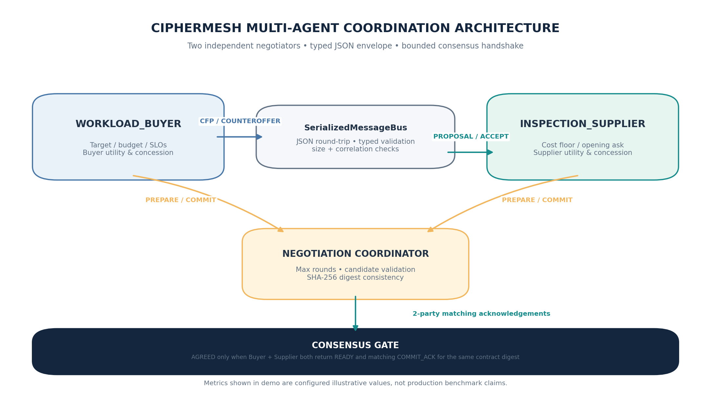
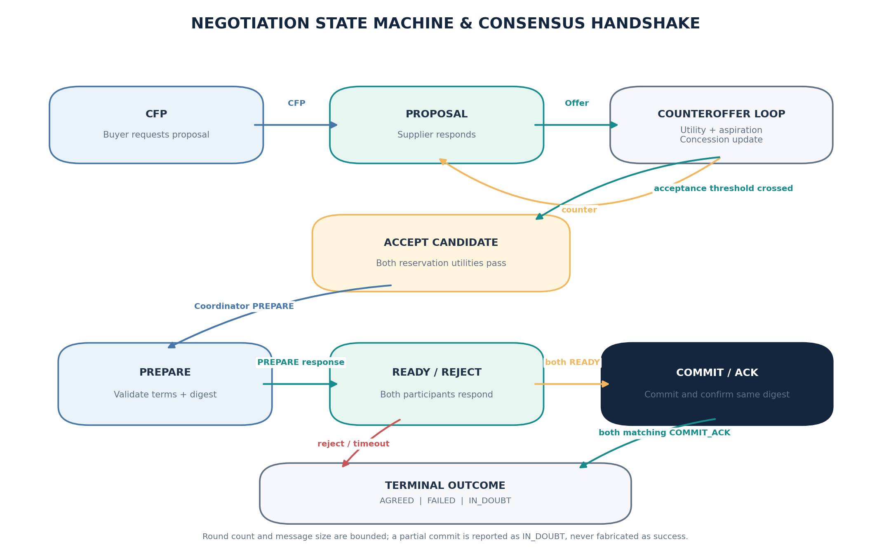
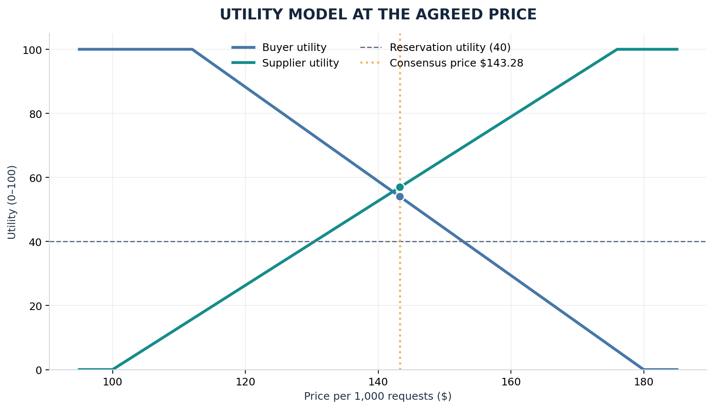

# CipherMesh Multi-Agent Coordination Protocol Execution

**Implementation report and reproducible demonstration**  
**Student:** Kumar Waibhav Akshat  
**Registration ID:** RA2212704010027  
**Programme:** Integrated M.Tech, Computer Science & Engineering (Data Science)  
**Section:** AG1  
**Project:** CipherMesh — Multi-Cloud LLM Privacy Gateway  
**Version:** 0.3.0  
**Report date:** 12 October 2026

---

## Executive summary

This deliverable adds an executable multi-agent coordination protocol to CipherMesh. Two different agent instances, `WORKLOAD_BUYER` and `INSPECTION_SUPPLIER`, negotiate a service contract for privacy-inspection capacity. Their positions are not static: each instance computes utility from the current proposal, compares it with a turn-sensitive aspiration threshold, and updates its next stance using a bounded concession rule.

The negotiation is Contract-Net-inspired: the buyer issues a Call for Proposal (CFP), the supplier returns an initial proposal, and both agents alternate counteroffers until one explicitly accepts an offer. An agreement candidate is not considered committed at that point. The coordinator runs a consensus handshake: both agents independently validate the full contract and its SHA-256 digest (`PREPARE` -> `READY`), then commit and acknowledge the same digest (`COMMIT` -> `COMMIT_ACK`). Only two matching acknowledgements produce `AGREED`.

The default local scenario terminates in five negotiation rounds at **$143.28 per 1,000 requests**, with buyer utility **54.00/100** and supplier utility **56.95/100**. Capacity, latency, and recall values are synthetic scenario inputs used to demonstrate the protocol; they are not measured product claims. The execution also has a bounded failure path when no acceptable overlap exists.

## 1. Objective and acceptance criteria

The goal is to implement and demonstrate a controlled multi-agent negotiation environment in which distinct agent instances exchange metrics, adjust offers according to utility, and reach an explicit consensus handshake.

The solution is assessed against these criteria:

1. **Multi-instance setup stability:** unique agent identities, typed role-specific state, bounded rounds, and deterministic default inputs.
2. **Negotiation protocol implementation:** CFP, proposal, counteroffer, acceptance/rejection and stateful concessions.
3. **Utility-driven behavior:** each side derives utility from price and evaluates offers against an aspiration and reservation threshold.
4. **Consensus handshake termination:** two parties prepare the same canonical contract, commit it, and acknowledge a matching digest before the result is declared agreed.
5. **Traceability:** every wire-like message is JSON serialized and revalidated; an ordered terminal timeline records sender, recipient, stage, byte length, turn and summary.
6. **Failure handling:** invalid service-level terms, too-low budgets, malformed messages, invalid commit order, or transport-size violations must not be misreported as consensus.

## 2. Scenario and agent responsibilities

CipherMesh protects model interactions by inspecting content before it reaches an LLM provider. The coordination exercise models a workload team buying a configured privacy-inspection service from a supplier agent. This scenario is intentionally small and deterministic, so the algorithm can be inspected during a classroom demonstration.

| Agent | Role | Private preferences | State changed during negotiation |
|---|---|---|---|
| `WORKLOAD_BUYER` | Initiator and service consumer | Target price, maximum budget, minimum utility, capacity/latency/recall SLOs | Current counteroffer and pending/committed contract |
| `INSPECTION_SUPPLIER` | Bidder and service provider | Cost floor, opening ask, minimum utility, configured service profile | Current ask and pending/committed contract |
| `NEGOTIATION_COORDINATOR` | Protocol controller, not a third commercial bidder | Round bound and agreement verification | Tracks messages, readiness, digest and termination result |

The coordinator only orchestrates protocol phases. It does not choose a price on behalf of either participant, and its presence does not replace the two independent utility calculations.

## 3. Architecture

The example uses two real Python objects with distinct IDs. The local `SerializedMessageBus` creates a JSON wire representation, validates it back into the typed message schema, checks frame-size limits, invokes the intended agent, then validates the response identity and correlation ID. This delivers a repeatable multi-agent simulation without a cloud account or an external service.

The coordination module is separate from the prior TCP socket exercise. Use `python -m ciphermesh.negotiation.demo` for this negotiation trace. Use `python -m ciphermesh.server` and `python -m ciphermesh.client` for the separate distributed TCP state-sync task. The negotiation bus is in-process and should not be described as remote TCP transport.



### Message contract

Every negotiation message carries:

- `schema_version`: versioned envelope marker;
- `message_id`: fresh unique identifier for this message;
- `negotiation_id`: correlates the complete conversation;
- `sender` and `recipient`: explicit participant identities;
- `stage`: enumerated protocol stage;
- `turn`: bounded non-negative turn count;
- `timestamp` and `correlation_id`;
- `payload`: typed-by-stage fields such as contract terms, utility, aspiration, digest or reason.

Contract terms contain `price_per_1000_requests`, `capacity_rps`, `p95_latency_ms`, `estimated_recall`, duration, and a provenance note that labels scenario metrics as illustrative. Unknown envelope fields are rejected by Pydantic (`extra="forbid"`).

## 4. Protocol design

### Phase A — Call for proposal

The buyer sends `CALL_FOR_PROPOSAL` with its budget and service constraints. The supplier returns a `PROPOSAL` containing its opening ask and current service profile. The buyer first checks the proposal against its service-level objectives: minimum capacity, maximum p95 latency, and minimum recall. A service profile that fails these constraints is rejected before price negotiation can continue.

### Phase B — Alternating offers

The buyer and supplier alternate `COUNTEROFFER` messages. Each response includes the proposed contract terms, computed utility, aspiration threshold, concession rate, and a short reason. Offers move toward the other party's latest stance; the buyer is capped at its explicit budget, and the supplier protects a reservation price calculated from its cost floor and minimum utility.

### Phase C — Acceptance candidate

An offer is acceptable when its recipient utility meets both (a) the turn-specific aspiration threshold and (b) the minimum reservation utility. A candidate price also has to satisfy both parties' reservation utility. If an offer cannot be accepted within the configured maximum number of rounds, the protocol returns `FAILED` with no contract.

### Phase D — Consensus handshake

The agreement candidate is canonicalized as sorted contract JSON and hashed with SHA-256. The digest is a consistency identifier, not an authentication signature.

1. Coordinator sends `PREPARE` plus the exact terms and digest to the buyer. The buyer validates schema, digest, utility and SLOs, stores a pending contract, and returns `READY`.
2. The same `PREPARE` is sent to the supplier. It performs its own validation and returns `READY` only for the same digest and an acceptable price.
3. Only if both are ready does the coordinator send `COMMIT` to each participant.
4. Each participant moves its prepared contract into committed state and returns `COMMIT_ACK` with the same digest.
5. The coordinator reports `AGREED` only when both distinct participants acknowledge that same digest.

If a commit acknowledgement is missing after another participant has committed, the accurate outcome is `IN_DOUBT`, not success or automatic rollback. This mirrors the distributed-systems limitation that a coordinator cannot infer the remote commit state from a lost response.



## 5. Utility model

Utilities are bounded to 0-100. They are explainable linear formulas for this controlled exercise; real procurement or production policy should use empirically justified utility curves and calibrated stakeholder constraints.

### Buyer utility

Let target price be \(p_t = 112\), and maximum budget be \(p_{max} = 180\). The buyer utility is:

\[
U_B(p)=100\cdot\operatorname{clip}\left(\frac{p_{max}-p}{p_{max}-p_t},0,1\right)
\]

A price at or below the target obtains utility 100; utility declines linearly to 0 at the budget ceiling. The default buyer reservation utility is 40.

### Supplier utility

Let supplier cost floor be \(c=100\) and opening ask be \(p_s=176\). The supplier utility is:

\[
U_S(p)=100\cdot\operatorname{clip}\left(\frac{p-c}{p_s-c},0,1\right)
\]

The reservation utility is 40, so the supplier does not commit below the price implied by its floor and minimum utility.

### Dynamic aspiration and concession

Both sides start with a high aspiration threshold and relax it as rounds advance:

\[
A(t)=\max(U_{min}, 92-9t)
\]

Buyer concession rate for round \(t\):

\[
\alpha_B(t)=\min(0.40,0.12+0.035t)
\]

Supplier concession rate for round \(t\):

\[
\alpha_S(t)=\min(0.42,0.14+0.04t)
\]

Given the previous stance \(x\) and the other party's proposal \(y\), the next stance shifts by a bounded fraction of the gap: \(x' = x + \alpha(y-x)\). The supplier applies the equivalent downward concession to its ask. These rates are configurable and intentionally transparent; they make the sample convergent without hard-coding the settlement price.



## 6. Verified execution timeline

The default execution was run using `python -m ciphermesh.negotiation.demo`. The full console transcript is included at `docs/examples/multi_agent_negotiation_timeline.txt`; the same structured result is included as `docs/examples/negotiation_result.json`.

### Offer turns

| Turn | Supplier's preceding ask | Buyer counteroffer | Buyer utility at counter | Supplier action |
|---:|---:|---:|---:|---|
| 1 | $176.00 | $121.92 | 85.4 | Counters at $166.27 |
| 2 | $166.27 | $130.35 | 73.0 | Counters at $158.37 |
| 3 | $158.37 | $136.65 | 63.8 | Counters at $152.72 |
| 4 | $152.72 | $140.83 | 57.6 | Counters at $149.15 |
| 5 | $149.15 | $143.28 | 54.0 | Accepts buyer counteroffer |

The fifth-round offer gives the supplier utility 56.95, above its reservation utility of 40 and the turn-5 aspiration threshold of 47. The buyer utility is 54.00, also above the reservation utility. Service constraints are satisfied by the configured profile: 600 requests/s, p95 latency 18 ms, estimated recall 97%.

### Consensus messages

| Sequence | Sender -> recipient | Stage | Purpose |
|---:|---|---|---|
| 13-14 | Coordinator -> Buyer -> Coordinator | `PREPARE` / `READY` | Buyer validates contract and digest; utility 54.00 |
| 15-16 | Coordinator -> Supplier -> Coordinator | `PREPARE` / `READY` | Supplier validates same contract and digest; utility 56.95 |
| 17-18 | Coordinator -> Buyer -> Coordinator | `COMMIT` / `COMMIT_ACK` | Buyer moves prepared terms to committed state |
| 19-20 | Coordinator -> Supplier -> Coordinator | `COMMIT` / `COMMIT_ACK` | Supplier commits the same contract digest |
| 21 | Coordinator -> local runtime | `CONSENSUS_CONFIRMED` | Both distinct acknowledgement identities match |

The default run contains 20 JSON-serialized protocol messages and 21 timeline events (the final event is a local coordinator note rather than a wire message). Settlement price: **$143.28 per 1,000 requests**. The contract digest is printed by the demo and saved in the JSON result.

## 7. Source layout

| File | Responsibility |
|---|---|
| `ciphermesh/negotiation/models.py` | Enumerated stages, strict message schema, contract terms, timeline and result models |
| `ciphermesh/negotiation/agents.py` | Role-specific utility formulas, offers, counteroffers, prepare/commit validation and local state |
| `ciphermesh/negotiation/transport.py` | Serialized JSON round-trip, size limit, recipient/correlation validation and event log |
| `ciphermesh/negotiation/protocol.py` | CFP flow, bounded round loop, candidate checks, handshake, result/termination states |
| `ciphermesh/negotiation/demo.py` | CLI demonstration and optional JSON export |
| `tests/test_negotiation.py` | Success, bounded failure, SLO rejection, digest determinism, distinct IDs and handshake-state tests |
| `docs/examples/multi_agent_negotiation_timeline.txt` | Sample terminal transcript |
| `docs/examples/negotiation_result.json` | Machine-readable timeline and result |

## 8. Installation and execution

Python 3.10+ and the project dependency (`pydantic>=2.6`) are required. Tests use `pytest`.

### Windows PowerShell

```powershell
cd ciphermesh
py -3.11 -m venv .venv
.\.venv\Scripts\Activate.ps1
python -m pip install --upgrade pip
pip install -e ".[dev]"
python -m ciphermesh.negotiation.demo
```

### macOS / Linux

```bash
cd ciphermesh
python3 -m venv .venv
source .venv/bin/activate
python -m pip install --upgrade pip
pip install -e ".[dev]"
python -m ciphermesh.negotiation.demo
```

To export a machine-readable trace:

```bash
python -m ciphermesh.negotiation.demo --json-out docs/examples/negotiation_result.json
```

To demonstrate bounded no-agreement termination with a budget below the supplier's reservation range:

```bash
python -m ciphermesh.negotiation.demo --buyer-max-price 120 --max-rounds 6
```

The failure demo intentionally exits with status code 2 because no consensus has been reached; this is expected. The normal demonstration should finish with `Status: AGREED`.

## 9. Verification

The combined CipherMesh suite was run after adding the negotiation module:

```text
31 passed
```

Coverage includes the pre-existing privacy policy, TCP transport and gateway tests, as well as the new negotiation tests:

- two distinct agents reach consensus and commit the same contract;
- expected protocol stages appear in the serialized timeline;
- a restrictive budget terminates without a fabricated agreement within the round bound;
- supplier metrics that fail the buyer's SLO are rejected;
- digest calculation is stable for the same canonical contract;
- duplicate participant IDs are rejected by the coordinator;
- COMMIT without a matching PREPARE and PREPARE with a tampered contract digest are rejected; oversized message frames fail closed.

These are deterministic unit/integration tests, not a statistical evaluation of negotiation quality, network throughput, or live cloud deployment.

## 10. Stability, safety and known limitations

- **Distinct identity:** buyer and supplier IDs must differ. Replies must match the expected sender, recipient, negotiation ID and correlation ID.
- **Bounded execution:** the coordinator limits rounds to 1-100 and ends with `FAILED` if no mutually acceptable offer emerges.
- **Serialized payloads:** every bus request and response passes through JSON serialization and typed validation; oversized messages are rejected.
- **Service constraints:** the buyer checks capacity, p95 latency and estimated recall before negotiating price.
- **Digest binding:** both participants validate the exact same contract digest before acknowledging readiness and commit.
- **Partial commit semantics:** if a participant commits but its acknowledgement cannot be confirmed, the result should be `IN_DOUBT`; do not pretend that an unseen remote result is rolled back.
- **Illustrative economics:** price, capacity, latency and recall numbers are configured demonstration values, not live market prices or validated detector performance.
- **Local transport only:** the negotiation module uses an in-process JSON message bus for deterministic repeatability. It is not a TCP/RPC deployment. The base CipherMesh TCP client/server module is a separate networking demonstration.
- **Security:** SHA-256 digest verifies equality of the contract payload, not sender identity or authenticity. For remote deployments, add authenticated channels, signed messages or mTLS, authorization, replay persistence, idempotency keys and durable transaction state.
- **Persistence:** negotiation state is currently held in memory. A production coordinator requires a durable state machine, restart recovery, decision logs and idempotent commit processing.

## 11. Next engineering steps

1. Extract `NegotiationParticipant` as a transport-independent protocol interface and implement a TCP/JSON-RPC transport using the same envelope.
2. Persist negotiation state and idempotency keys, and add restart/recovery tests.
3. Add a signed, versioned contract record and participant authentication for multi-host coordination.
4. Run parameter sweeps over initial anchors, concession rates, thresholds and round limits; report agreement rate, average rounds, utility distribution and no-agreement rate.
5. Use measured latency/recall observations from a labeled benchmark rather than synthetic profile inputs.
6. Extend the coordinator to multi-bidder Contract Net: CFP broadcast, multiple supplier proposals, winner selection by declared utility/constraints, then the same two-party consensus handshake with the selected bidder.

## Appendix A — Stage reference

| Stage | Origin | Receiver behavior | Termination meaning |
|---|---|---|---|
| `CALL_FOR_PROPOSAL` | Buyer | Supplier inspects requirements and responds with a service profile | Starts one negotiation ID |
| `PROPOSAL` | Supplier | Buyer validates service constraints and evaluates utility | Initial supplier stance |
| `COUNTEROFFER` | Buyer or Supplier | Other party evaluates utility and adjusts stance or accepts | Continues bounded offer loop |
| `ACCEPT` | Buyer or Supplier | Recipient validates accepted terms and reservation utility | Candidate agreed, not yet committed |
| `PREPARE` | Coordinator | Participant validates schema, SLOs, utility and digest | Prepares local pending state |
| `READY` | Participant | Coordinator compares digest and participant identity | Necessary but insufficient for consensus |
| `COMMIT` | Coordinator | Participant commits previously prepared digest only | Finalizes that participant's local contract |
| `COMMIT_ACK` | Participant | Coordinator requires both distinct matching acknowledgements | Enables `AGREED` result |
| `REJECT` / `ERROR` | Any endpoint | Coordinator stops or reports failure | No false success |
| `ABORT` / `ABORT_ACK` | Coordinator / participant | Clears pending state when prepare fails | Cancels uncommitted candidate |

## Appendix B — Why the handshake exists

An offer accepted in a conversational protocol does not automatically guarantee that both participants have persisted the same terms. The two-phase prepare/commit exchange adds a small explicit agreement boundary. `READY` proves that the participant has checked and staged the same canonical terms; `COMMIT_ACK` confirms local commit for that digest. The coordinator waits for both identities before displaying consensus. For true distributed deployment this must be paired with durable logs and reconciliation logic because a network partition can leave the coordinator uncertain about a participant's commit state.
