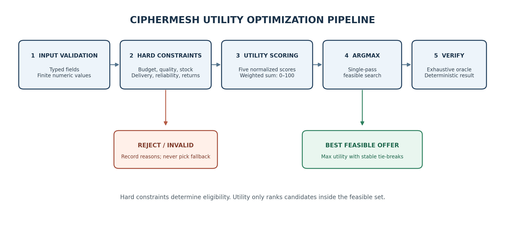
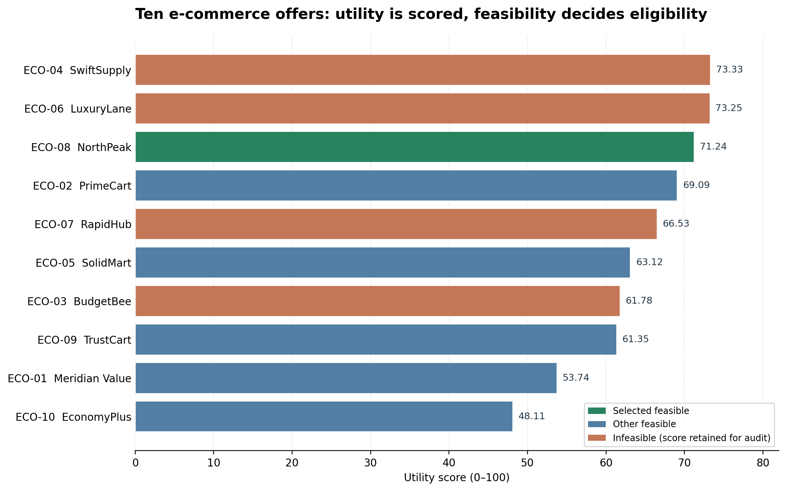

## Contents

1. Executive summary
2. Objective and scope
3. Architecture
4. Scenario and constraints
5. Mathematical utility model
6. Search algorithm
7. Ten-option evaluation
8. Robustness and constraint boundaries
9. Reproduce the execution
10. Automated verification
11. Project component map
12. Limitations and production next steps
13. Conclusion

## Executive summary

This module implements a self-interested decision agent that chooses the best supplier offer for an e-commerce order. It does not merely select the cheapest product or the highest raw score. It evaluates price, product quality, delivery speed, reliability, return risk, stock availability, seller status, and destination support together. A weighted utility equation expresses trade-offs between competing commercial objectives, while explicit hard constraints prevent an attractive score from compensating for an unacceptable operational condition.

Ten deliberately varied supplier options are evaluated. Six pass all hard constraints, and four are excluded. The selected offer is **ECO-08 / NorthPeak**, with a landed unit cost of **$131.00** and a utility score of **71.2388 out of 100**. The decision is also compared with an independent exhaustive reference implementation. The reference selects the same option, so the demo records `optimality_verified = true`.

A key safety result is that SwiftSupply receives a raw utility of approximately **73.33**, higher than NorthPeak's score, but is rejected because it has only 80 units available while the order requires 100. CipherMesh therefore chooses the highest-utility *feasible* offer, not the highest-scoring infeasible offer. The selection is reproducible, constraints are explicit, and failure states are surfaced rather than silently bypassed.

## 1. Objective and scope

### 1.1 Objective

Formulate and execute a mathematical utility evaluator for an autonomous e-commerce procurement agent, search ten complex offer configurations, reject configurations that violate operational constraints, and choose the global utility maximum within the feasible set.

### 1.2 What is delivered

- Typed and validated models for offers, weights, constraints, score breakdowns, candidate evaluations, and results.
- A five-factor utility equation with configurable weights that must sum to one.
- A constraint-first optimization pipeline and deterministic tie-breaking policy.
- A ten-option reproducible e-commerce dataset.
- A single-pass winner search and a separate exhaustive reference oracle for programmatic optimality verification.
- Robust handling of malformed inputs, non-finite numbers, duplicate identifiers, empty input, no feasible option, exact constraint boundaries, and the one-day delivery edge case.
- Automated tests, a terminal demonstration, CSV/JSON evidence, and this implementation report.

### 1.3 Deliberate scope boundaries

The supplier offers and scores are synthetic scenario data for a controlled demonstration. The module does not place orders, contact sellers, charge payment methods, or claim empirical market performance. Utility weights are a documented decision policy and should be calibrated and approved for a real business context.

## 2. Architecture



The decision path is deliberately ordered:

1. **Validate:** parse each input as a typed `Offer`; reject malformed records as `INVALID_DATA` without crashing the other candidates.
2. **Protect identifier integrity:** if multiple valid input rows share an `option_id`, mark every duplicate occurrence invalid instead of arbitrarily choosing one.
3. **Calculate:** derive the landed cost and five normalized component scores for every valid record.
4. **Enforce constraints:** mark candidates `INFEASIBLE` if any hard constraint fails. They may retain an explanatory score, but cannot become the winner.
5. **Optimize:** scan feasible candidates once, maintaining the best incumbent according to the utility/tie-break ordering.
6. **Audit:** produce a sorted feasible ranking and compare the selected offer against an independent exhaustive reference routine.
7. **Report:** return a typed result and optionally persist CSV and JSON evidence.

The module is under `ciphermesh/optimization/` and is independent of external cloud inference. It can be used as a decision component by a larger CipherMesh workflow without requiring a model API call.

## 3. Scenario and constraints

The agent is selecting a supplier to fulfil an order of 100 units for a single destination. Price includes item cost plus per-unit shipping. The default global constraint set is:

| Constraint | Default | Meaning |
|---|---:|---|
| Maximum landed cost per unit | $145.00 | Item price plus shipping must not exceed the budget |
| Required quantity | 100 units | Available stock must satisfy the full order |
| Minimum quality rating | 4.0 / 5.0 | Excludes below-standard product offers |
| Maximum delivery time | 5 days | Rejects delivery outside the target window |
| Minimum reliability | 95% | Excludes unreliable fulfilment profiles |
| Maximum return rate | 6% | Rejects excessive return risk |
| Seller active | True | Inactive offers cannot be selected |
| Destination supported | True | Seller must serve the target region |

These are hard gates, not utility penalties. If no offer meets all criteria, the optimizer returns `NO_FEASIBLE_OPTION` and does not relax constraints or choose the least-bad rejected candidate.

## 4. Mathematical utility model

### 4.1 Notation

For offer \(i\):

- \(P_i\): item price per unit.
- \(S_i\): shipping cost per unit.
- \(L_i = P_i + S_i\): landed cost per unit.
- \(B\): maximum allowed landed cost per unit.
- \(Q_i\): quality rating on the 0-5 scale.
- \(d_i\): estimated delivery days.
- \(D_{max}\): maximum allowed delivery days.
- \(R_i\): seller reliability percentage.
- \(t_i\): expected return-rate percentage.
- \(T_{scale}\): return-rate scoring reference, 10% in the default profile.
- \(clamp(x,0,100)\): restricts a score to the 0-100 interval.

### 4.2 Component scores

**Quality score**

\[
q_i = clamp\left(100\frac{Q_i}{5},0,100\right)
\]

**Cost score**

\[
c_i = clamp\left(100\left(1-\frac{L_i}{B}\right),0,100\right)
\]

A lower landed price receives a higher score. Any offer that exceeds the budget is infeasible regardless of this score.

**Delivery score**

For \(D_{max}>1\):

\[
dscore_i = clamp\left(100\frac{D_{max}-d_i}{D_{max}-1},0,100\right)
\]

For the edge case \(D_{max}=1\), the score is 100 for one-day delivery and 0 otherwise. This avoids dividing by zero. Among acceptable delivery values, one day maps to 100 and the maximum permitted delivery time maps to 0.

**Reliability score**

\[
r_i = clamp(R_i,0,100)
\]

**Return-risk score**

\[
tscore_i = clamp\left(100\left(1-\frac{t_i}{T_{scale}}\right),0,100\right)
\]

A lower return rate scores better. The scoring reference is not the same as the hard limit: the default hard limit is 6%, while the normalization reference is 10%.

### 4.3 Weighted utility equation

\[
\boxed{U_i = 0.30q_i + 0.25c_i + 0.20dscore_i + 0.15r_i + 0.10tscore_i}
\]

| Factor | Weight | Rationale |
|---|---:|---|
| Product quality | 0.30 | Customer outcome and product suitability are the largest single factor |
| Landed cost | 0.25 | Commercial efficiency is important but cannot override a hard budget gate |
| Delivery speed | 0.20 | Faster fulfilment improves convenience and reduces waiting time |
| Reliability | 0.15 | More dependable suppliers reduce expected fulfilment risk |
| Return risk | 0.10 | Lower return rates reduce customer friction and reverse-logistics exposure |
| **Total** | **1.00** | Weights are validated to sum to one |

Utility is a policy score, not a probability. A score of 71.2388 means that the configured weighted evaluator assigns that relative score on its 0-100 scale; it does not mean a 71.2% probability of success.

### 4.4 Objective and tie-breaking

Let \(F\) be the set of offers that pass every hard constraint. The optimization objective is:

\[
 i^* = \arg\max_{i \in F} U_i
\]

If the top scores tie, the deterministic ordering is: (1) lower landed cost, (2) fewer delivery days, and (3) lexicographically smaller option ID. The tie rule makes repeated runs stable and testable.

## 5. Search algorithm

The production selector uses an incumbent search, not exhaustive permutation generation:

```text
best = NONE
for each validated offer:
    calculate the component scores and utility
    if any hard constraint fails:
        record INFEASIBLE with every applicable reason
        continue
    if best is NONE or candidate beats best by utility/tie-break rule:
        best = candidate
return best or NO_FEASIBLE_OPTION
```

- **Time complexity for winner selection:** \(O(n)\), because each offer is evaluated once.
- **Memory complexity for evaluation output:** \(O(n)\), because the result preserves one evaluation per input record.
- **Optional ranking:** sorting the \(k\) feasible offers costs \(O(k\log k)\), where \(k\le n\).
- **Optimality evidence:** the demo calls `exhaustive_reference_winner` on the valid candidate set and checks that its result matches the single-pass selector. This reference is audit/test code; the production selection path remains a single scan.

Because the scoring function is deterministic and every feasible candidate is evaluated, maintaining the best incumbent under the same total ordering is sufficient to produce the utility maximum for the configured finite input set. The exhaustive comparison is additional implementation evidence, not a claim about every possible real-world seller not present in the candidate set.

## 6. Ten-option evaluation

The exact reproducible input dataset is defined in `ciphermesh/optimization/scenarios.py`. Prices, quality, delivery, reliability, return rates, stock, seller activation, and destination support are distinct properties; the candidates are not merely ten price numbers.



| ID | Seller | Landed cost | Utility / 100 | Outcome | Principal finding |
|---|---|---:|---:|---|---|
| ECO-01 | Meridian Value | $121.00 | 53.74 | FEASIBLE | All hard constraints pass |
| ECO-02 | PrimeCart | $130.00 | 69.09 | FEASIBLE | All hard constraints pass; runner-up |
| ECO-03 | BudgetBee | $108.00 | 61.78 | INFEASIBLE | Quality 3.7/5 below 4.0 and destination unsupported |
| ECO-04 | SwiftSupply | $145.00 | 73.33 | INFEASIBLE | Only 80 units in stock; order requires 100 |
| ECO-05 | SolidMart | $122.00 | 63.12 | FEASIBLE | All hard constraints pass |
| ECO-06 | LuxuryLane | $148.00 | 73.25 | INFEASIBLE | Landed cost exceeds the $145 budget |
| ECO-07 | RapidHub | $117.00 | 66.53 | INFEASIBLE | Reliability 94% below the 95% minimum |
| ECO-08 | NorthPeak | $131.00 | **71.2388** | **SELECTED** | Highest utility among feasible offers |
| ECO-09 | TrustCart | $127.00 | 61.35 | FEASIBLE | All hard constraints pass |
| ECO-10 | EconomyPlus | $111.00 | 48.11 | FEASIBLE | Meets all gates but slower and higher return risk |

The `demo` command prints unrounded utility values for the selected result, while the table above is rounded for readability. The CSV/JSON evidence in `docs/examples/` preserves machine-readable candidate-level output.

### 6.1 Why not select the highest raw score?

SwiftSupply's utility score is higher than NorthPeak's, but it cannot supply the required quantity. A utility-only maximum would make an invalid procurement choice. CipherMesh first constructs the feasible set, then optimizes within it. Similarly, LuxuryLane scores well on quality and speed but is rejected because its total unit cost is $148, above the budget. These two examples demonstrate the distinction between a preference score and a binding resource constraint.

## 7. Robustness and constraint boundaries

The evaluator uses Pydantic validation and explicit result states to avoid unsafe silent behavior.

| Boundary or failure | Behavior |
|---|---|
| Negative item/shipping price | Candidate becomes `INVALID_DATA` |
| NaN or infinity in a numeric field | Candidate becomes `INVALID_DATA` |
| Quality outside 0-5; percent outside 0-100; invalid delivery/stock | Candidate becomes `INVALID_DATA` |
| Unknown schema fields | Candidate becomes `INVALID_DATA` rather than being silently ignored |
| Duplicate `option_id` | All occurrences of that ID become `INVALID_DATA` |
| Price equals budget exactly | Accepted if every other constraint passes |
| Quality/reliability/return/stock equals threshold | Accepted because the threshold comparisons are inclusive |
| Delivery bound is one day | Dedicated scoring branch prevents division by zero |
| Empty input list | Explicit `NO_OPTIONS` status |
| No feasible candidate | Explicit `NO_FEASIBLE_OPTION`; no fallback is selected |
| Invalid weight sum | Global constraint construction fails with validation error |
| Equal utility | Stable tie-breaking by cost, delivery, and ID |

Malformed rows are isolated so one bad seller record does not destroy the evaluations of every other candidate. Global configuration errors are different: invalid weights or contradictory scoring constraints must be fixed rather than ignored.

## 8. Reproduce the execution

### 8.1 Prerequisites

- Python 3.10 or newer.
- Pydantic 2.6 or newer (already a CipherMesh core dependency).
- Pytest for the full test suite.
- No cloud keys, model API, external database, or paid service required.

### 8.2 Install and execute

From the repository root (the directory containing `pyproject.toml`):

```powershell
# Windows PowerShell
py -3.11 -m venv .venv
.\.venv\Scripts\Activate.ps1
python -m pip install -e ".[dev]"
python -m ciphermesh.optimization.demo
```

macOS/Linux:

```bash
python3 -m venv .venv
source .venv/bin/activate
python -m pip install -e ".[dev]"
python -m ciphermesh.optimization.demo
```

Export machine-readable artifacts:

```bash
python -m ciphermesh.optimization.demo \
  --json-out docs/examples/utility_optimization_result.json \
  --csv-out docs/examples/utility_options_ranking.csv
```

To demonstrate no silent budget relaxation, run with a very restrictive budget:

```bash
python -m ciphermesh.optimization.demo --budget 100
```

The run should report `NO_FEASIBLE_OPTION` and not select an over-budget fallback. Test suite:

```bash
python -m pytest -q
```

### 8.3 Expected successful result

```text
EVALUATED=10 | VALID=10 | FEASIBLE=6 | REJECTED=4
FEASIBLE RANKING: ECO-08 > ECO-02 > ECO-05 > ECO-09 > ECO-01 > ECO-10

OPTIMIZER DECISION
  Selected seller  : NorthPeak (ECO-08)
  Landed unit cost : $131.00
  Utility score    : 71.2388 / 100
  Oracle comparison: PASS (single-pass winner=ECO-08; exhaustive reference=ECO-08)
```

A full saved output is provided in `docs/examples/utility_optimization_terminal_timeline.txt`.

## 9. Automated verification

The integrated test suite contains **53 passing tests** at the time this report was generated. The utility-optimization module contributes tests for:

- The ten-option expected winner and independent exhaustive optimality check.
- Hard constraints overriding a higher raw score.
- Component score and weighted-sum arithmetic.
- Exact boundaries and one-step-outside failures for price, quality, delivery, reliability, returns, stock, active status, and destination coverage.
- Isolated invalid rows, duplicate IDs, empty input, and no-feasible-option outcomes.
- Invalid weights and invalid global constraints.
- Negative values, NaN, infinity, and out-of-range numeric fields.
- Stable tie resolution and the one-day delivery edge case.
- Feasible ranking order and exclusion of infeasible candidate IDs.

The test count covers the existing CipherMesh privacy, TCP transport, gateway, and multi-agent negotiation tests as well as the new optimization tests. A passing test suite demonstrates the exercised scenarios, not universal correctness for every future integration or dataset.

## 10. Project component map

```text
ciphermesh/
  ciphermesh/optimization/
    __init__.py     Public optimization API
    models.py       Offer schema, hard constraints, weights and result models
    engine.py       Score calculation, feasibility gates, selection and oracle
    scenarios.py    Ten-offer reproducible data and default constraints
    demo.py         CLI output and CSV/JSON export
  tests/
    test_utility_optimization.py
  docs/
    CipherMesh_Utility_Optimization_Report.md / .docx / .pdf
    figures/utility_optimization_pipeline.png
    figures/utility_optimization_scores.png
    examples/utility_optimization_terminal_timeline.txt
    examples/utility_options_ranking.csv
    examples/utility_optimization_result.json
```

## 11. Limitations and production next steps

- Utility weights are hand-specified for an academic baseline. A real procurement policy should be calibrated with stakeholder input, historical service data, and sensitivity analysis.
- Scores assume the source fields are trustworthy. Production usage should verify supplier claims, timestamps, stock reservations, geography, tax, currency, and total landed cost from authoritative systems.
- Utility is linear and additive. It does not model attribute interactions, uncertainty intervals, correlated supplier failures, price breaks, minimum order quantity tiers, or multi-order inventory allocations.
- The demo is single-order and single-winner. A marketplace allocator with multiple orders and shared capacity would require a constrained optimization model (for example, linear/integer programming) rather than independent per-order ranking.
- The exhaustive reference checks only the same finite candidate set and rules. It cannot establish that no better unobserved supplier exists.
- Monetary inputs use floating-point numbers for a compact educational example. Real accounting or settlement paths should use integer minor units or `Decimal` with an explicit rounding policy.
- The module does not place an order. A real execution adapter should revalidate availability and price immediately before purchase and require appropriate approval for consequential actions.

## Conclusion

CipherMesh now contains a transparent and testable utility optimizer that demonstrates the required economic reasoning and constrained selection behavior. The utility equation defines the agent's preferences, feasibility rules encode non-negotiable limits, the single-pass search selects the best feasible candidate, and the exhaustive oracle provides programmatic evidence for the ten-option demonstration. Invalid input and infeasible configurations terminate explicitly rather than silently influencing a decision.
