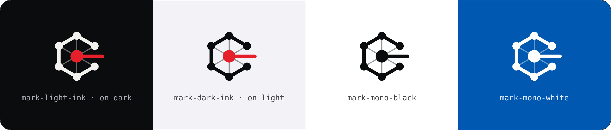
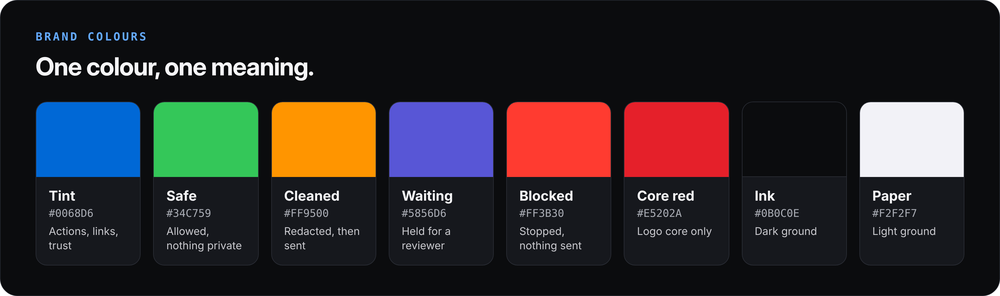

# CipherMesh brand guidelines
**The calm guard.** Precise, accountable, plain.

---

## 1. Logo

- **Meaning:** an open hexagon of six mesh nodes (every model) around a red core (the protected prompt). One red path leaves through the open side: the inspected gate.
- **Clear space:** two node-diameters on every side.
- **Minimum size:** 16 px for the mark alone, 120 px wide for a lockup.
- **Never** rotate the gate, stretch the mark, recolour the core, or place the red core on a red background. Use the mono white mark there instead.

| Asset | File |
|---|---|
| Banner (dark / light) | [`banner-dark.png`](assets/brand/banner-dark.png) · [`banner-light.png`](assets/brand/banner-light.png) |
| App icon | [`app-icon.svg`](assets/brand/app-icon.svg) |
| Social preview (1280 × 640) | [`social-preview.png`](assets/brand/social-preview.png) |

## 2. Colour

| Role | Meaning | Text on light | Text on dark | Fill |
|:--|:--|:--|:--|:--|
| **Tint** | Trust, “do this” | `#0058B0` | `#64AAFF` | `#0068D6` |
| **Safe** | Done, nothing private | `#176A2E` | `#30D158` | `#34C759` |
| **Cleaned** | Changed, caution | `#9A4300` | `#FFB340` | `#FF9500` |
| **Waiting** | Needs a person | `#4B48C4` | `#A5A3FF` | `#5856D6` |
| **Blocked** | Stopped | `#B0101A` | `#FF7870` | `#FF3B30` |

- **Text:** label `#1D1D1F` / `#F5F5F7` · secondary `#48484D` / `#C7C7CC` · tertiary `#636369` / `#A2A2A8`.
- **Grounds:** Paper `#F2F2F7` (light) and Ink `#0B0C0E` (dark).
- **Core red `#E5202A` is reserved for the logo core.** In the product, red only ever means “stopped”.
- Every text pairing meets **WCAG AA (4.5 : 1)** in both themes.

## 3. Typography

| Use | Typeface | Fallback |
|---|---|---|
| Interface and documents | **Inter** (SF Pro on Apple devices) | system sans-serif |
| Display headings | **Inter Display**, 700–800 | Inter |
| Machine output: IDs, hashes, traces, prompts | **JetBrains Mono** (SF Mono on Apple devices) | monospace |

## 4. Decision language

| Decision | Word shown to users | Colour |
|---|---|---|
| `ALLOW` | **Safe to send** | Safe |
| `REDACT` | **Private details hidden** | Cleaned |
| `REVIEW` | **Waiting for approval** | Waiting |
| `BLOCK` | **Blocked. Nothing was sent.** | Blocked |

Decision colours appear only on these four results, and **always with their word**. Colour never carries meaning alone.

## 5. Voice: the calm guard

| Be | Not |
|---|---|
| Precise | Technical for its own sake |
| Calm | Alarming |
| Plain | Clever |
| Accountable | Vague |

- **Say:** check, hide, hold, stop, sent / not sent, reviewer, change the key.
- **Avoid:** military-grade, unhackable, 100% secure, AI magic, blaming the user.

## 6. Pre-release brand check

1. Mark untouched, clear space kept.
2. Red appears only for the logo core and “Blocked”.
3. Decision colours only on the four results, always with their word.
4. All text at 4.5 : 1 or better in both themes.
5. No real secrets, keys or personal data in examples.
6. No claims beyond what the system proves.

---
© 2026 Kumar Waibhav Akshat. CipherMesh and the CipherMesh mark are names and marks of Kumar Waibhav Akshat.
