<div align="center">

<picture>
  <source media="(prefers-color-scheme: dark)" srcset="assets/brand/banner-dark.png">
  <source media="(prefers-color-scheme: light)" srcset="assets/brand/banner-light.png">
  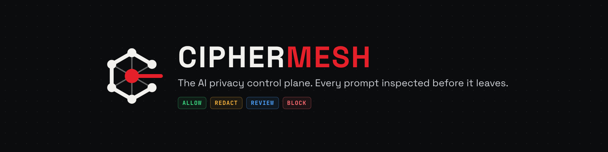
</picture>

<h3>Protect every prompt. Across every model. Before data leaves.</h3>

<p>An autonomous, multi-agent privacy control plane for enterprise AI.<br>Built for <b>21CSE525T Agent Technology</b> at SRM Institute of Science and Technology.</p>

<p>
<a href="https://ciphermesh-console.vercel.app"></a>
<a href="https://ciphermesh-api.vercel.app/docs"></a>
<a href="10_Assignment_5.2_Capstone_Secure_Deployment/video/CipherMesh_Capstone_Lifecycle.mp4"></a>
</p>

<p>


</p>

<p>
<a href="#-what-is-ciphermesh"><b>Overview</b></a> ·
<a href="#-how-a-request-flows"><b>How it works</b></a> ·
<a href="#-architecture"><b>Architecture</b></a> ·
<a href="#-results"><b>Results</b></a> ·
<a href="#-assignments"><b>Assignments</b></a> ·
<a href="#-final-review-rubric"><b>Rubric</b></a> ·
<a href="#-brand"><b>Brand</b></a>
</p>

</div>

---

## ◆ What is CipherMesh

Every team now sends company data to AI models: people paste emails and code into chat assistants, apps call model APIs, and agents act on their own. **Nobody checks what leaves.**

CipherMesh is one checkpoint between a company and every AI model it uses. It reads each prompt **before it leaves**, hides or stops what must stay private, keeps Indian personal data in India, and sends the rest to the best model it is allowed to use. It does this autonomously: it plans, re-plans when the world changes, negotiates with other agents, and only obeys commands it can cryptographically verify.

<p align="center">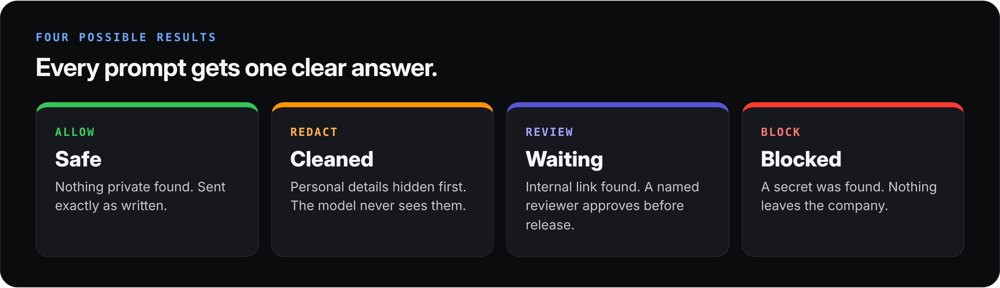</p>

<table>
<tr>
<td width="50%">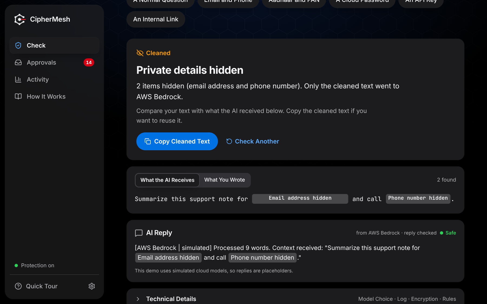<br><sub><b>Cleaned:</b> personal details hidden, only the cleaned text reached the model.</sub></td>
<td width="50%">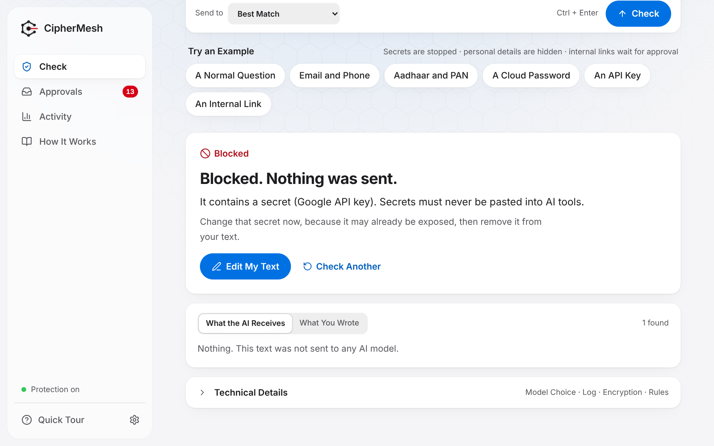<br><sub><b>Blocked:</b> an API key was found, so nothing was sent to any model.</sub></td>
</tr>
</table>

---

## ◆ How a request flows

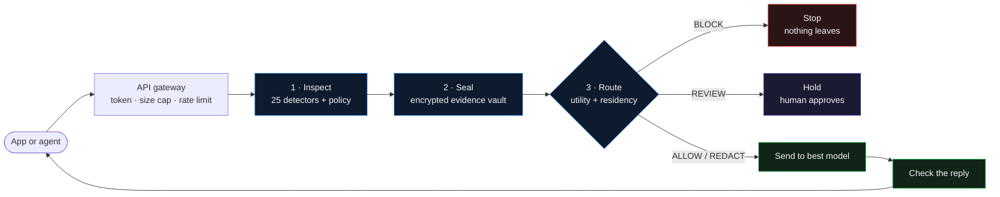

**Routing** scores every allowed model, then picks the best:

> **U = 0.30 · quality + 0.25 · cost + 0.20 · speed + 0.15 · uptime + 0.10 · privacy**
>
> Hard limits apply before any score: budget, latency, minimum quality, uptime, and **Aadhaar, PAN and Indian phone numbers stay in India or on-site**.

---

## ◆ Architecture

<p align="center">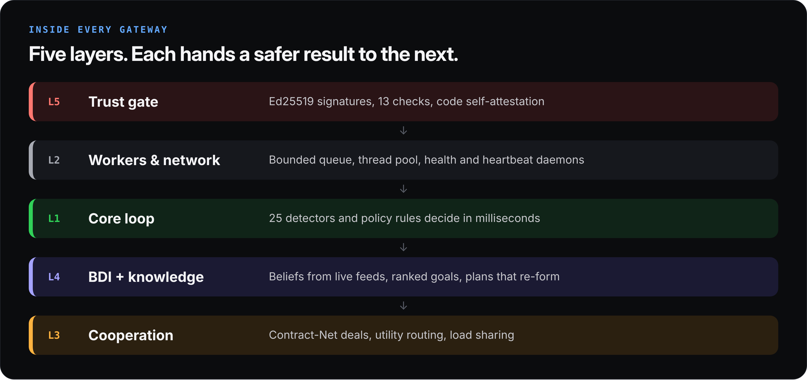</p>

<details open>
<summary><b>Full system schematic</b></summary>
<br>
<p align="center">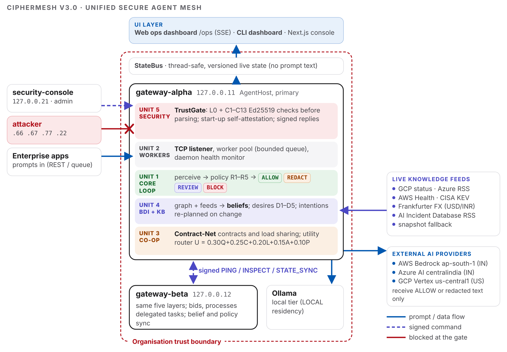</p>
</details>

| Layer | What it does | Built in |
|---|---|---|
| **Trust gate** | Verifies Ed25519-signed commands through 13 ordered checks; the agent checks its own code at start-up | 5.1 |
| **Workers & network** | Bounded queue, worker thread pool, health and heartbeat daemons, length-prefixed TCP messaging | 2.1 · 2.2 |
| **Core loop** | 25 detectors in 12 families (Luhn and Verhoeff checksums), policy rules R1–R5, strictest result wins | 1.2 |
| **BDI + knowledge** | Beliefs fed by a JSON-LD knowledge graph and 6 live public APIs; ranked desires; intentions re-planned on change | 4.1 · 4.2 |
| **Cooperation** | Contract-Net negotiation with consensus handshake, utility routing, load sharing between gateways | 3.1 · 3.2 |

---

## ◆ Results

<p align="center">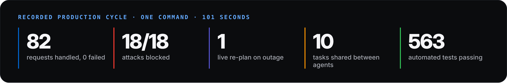</p>

<p align="center">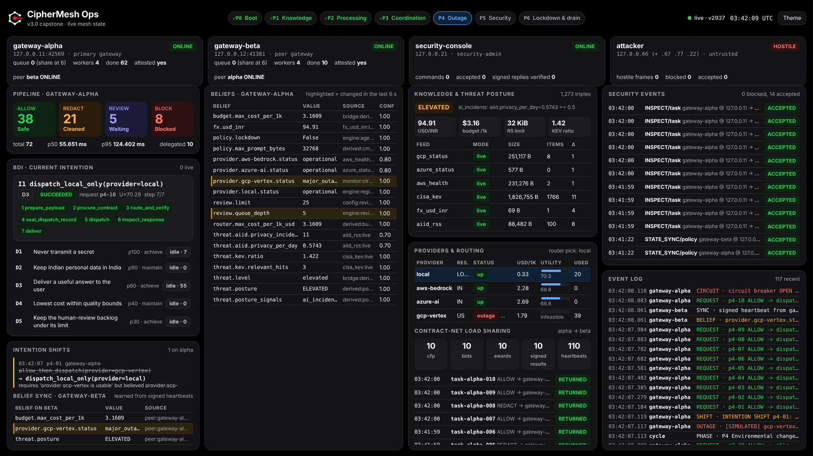</p>
<p align="center"><sub>Live operations dashboard, captured the moment a provider failed and the agent changed plan.</sub></p>

---

## ◆ Assignments

<p align="center">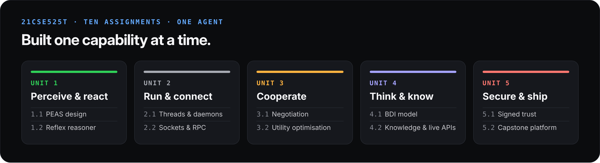</p>

| # | Assignment | Delivered | Evidence |
|:-:|---|---|---|
| **1.1** | Project Ideation, Environment Modeling & PEAS | Design specification, PEAS profile, agent vs. object contrast | [Report](01_Assignment_1.1_PEAS_Design_Specification/) |
| **1.2** | Rule-Based Environmental Reasoner | Condition–action reflex agent with execution log | [Folder](02_Assignment_1.2_Rule_Based_Reasoner/) |
| **2.1** | Concurrent Task Daemonization | Worker pool, monitor daemon; **7.6×** throughput with 8 workers | [Folder](03_Assignment_2.1_Concurrent_Task_Daemonization/) |
| **2.2** | Distributed Agent Messaging (Sockets/RPC) | Two-terminal TCP state transfer, Agent-A → Agent-B | [Folder](04_Assignment_2.2_Distributed_Agent_Messaging/) |
| **3.1** | Multi-Agent Coordination Protocol | Multi-turn negotiation, two-phase consensus handshake | [Folder](05_Assignment_3.1_Multi_Agent_Coordination/) |
| **3.2** | Self-Interested Utility Optimization | Optimal choice out of 10 options (**ECO-08, U = 71.24**) | [Folder](06_Assignment_3.2_Utility_Optimization/) |
| **4.1** | BDI Goal-Driven Modeling | 11/11 scenarios, **12 intention shifts**, 188 tests | [Folder](07_Assignment_4.1_BDI_Goal_Driven_Modeling/) |
| **4.2** | Knowledge Representation & Adaptive APIs | JSON-LD ontology, **6 live APIs**, 242 tests | [Folder](08_Assignment_4.2_Knowledge_Representation_Adaptive_API/) |
| **5.1** | Agent Authentication & Host Integrity | **41/41 attacks blocked**, code self-attestation, 269 tests | [Folder](09_Assignment_5.1_Agent_Authentication_Host_Integrity/) |
| **5.2** | Capstone Consolidation & Secure Deployment | Unified platform, dashboards, video, schematic, **563 tests** | [Folder](10_Assignment_5.2_Capstone_Secure_Deployment/) |
| — | **Final review** | 56-page project report and review presentation | [Folder](11_Final_Review/) |

---

## ◆ Final review rubric

| Criterion · 2.5 marks each | Where to look |
|---|---|
| **Architecture & BDI integration**<br><sub>layer consolidation, BDI data architecture, background daemons, knowledge representation / API integration</sub> | [Schematic](10_Assignment_5.2_Capstone_Secure_Deployment/architecture/) · [BDI](07_Assignment_4.1_BDI_Goal_Driven_Modeling/) · [Daemons](03_Assignment_2.1_Concurrent_Task_Daemonization/) · [Knowledge & APIs](08_Assignment_4.2_Knowledge_Representation_Adaptive_API/) |
| **Autonomous execution & optimization**<br><sub>sensory input, utility function, dynamic re-planning, no human intervention</sub> | [Utility function](06_Assignment_3.2_Utility_Optimization/) · [Intention shifts](07_Assignment_4.1_BDI_Goal_Driven_Modeling/) · [Production cycle log](10_Assignment_5.2_Capstone_Secure_Deployment/logs/production_cycle.log) |
| **Multi-agent coordination & security**<br><sub>socket/RPC messaging, multi-turn negotiation to consensus, cryptographic verification</sub> | [Sockets](04_Assignment_2.2_Distributed_Agent_Messaging/) · [Negotiation](05_Assignment_3.1_Multi_Agent_Coordination/) · [Breach simulation](09_Assignment_5.1_Agent_Authentication_Host_Integrity/) |
| **System UI & documentation**<br><sub>live dashboard, architecture schematic, full lifecycle presentation</sub> | [Dashboard captures](10_Assignment_5.2_Capstone_Secure_Deployment/logs/dashboard_snapshots/) · [Video](10_Assignment_5.2_Capstone_Secure_Deployment/video/) · [Report & presentation](11_Final_Review/) |

---

## ◆ Repository map

```text
CipherMeshAgent/
├── 01_Assignment_1.1_PEAS_Design_Specification/
├── 02_Assignment_1.2_Rule_Based_Reasoner/
├── 03_Assignment_2.1_Concurrent_Task_Daemonization/
├── 04_Assignment_2.2_Distributed_Agent_Messaging/
├── 05_Assignment_3.1_Multi_Agent_Coordination/
├── 06_Assignment_3.2_Utility_Optimization/
├── 07_Assignment_4.1_BDI_Goal_Driven_Modeling/
├── 08_Assignment_4.2_Knowledge_Representation_Adaptive_API/
├── 09_Assignment_5.1_Agent_Authentication_Host_Integrity/
├── 10_Assignment_5.2_Capstone_Secure_Deployment/   report · video · logs · schematic
├── 11_Final_Review/                                 project report · presentation
├── assets/                                          brand kit and README graphics
├── BRAND.md                                         brand guidelines
└── LICENSE
```

Each assignment folder has its own `README.md`, the files **as submitted** in `submission/`, and a standalone `report/` where one was submitted. The unified product source for 5.2 is maintained privately and can be demonstrated live on request.

---

## ◆ Brand

<p align="center">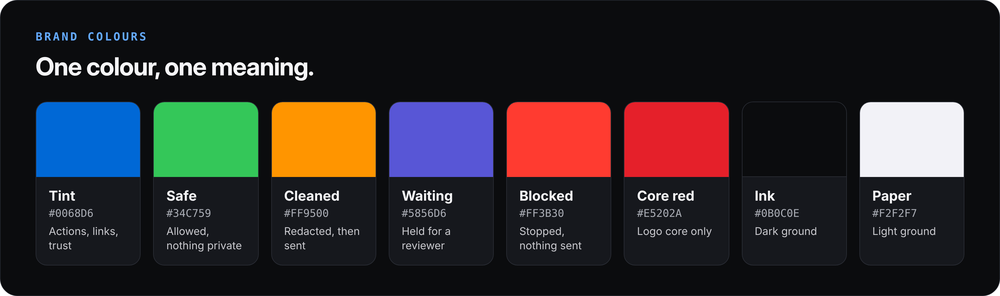</p>

The mark is an open hexagon of six mesh nodes (every model) around a red core (the protected prompt), with one path leaving through the open side (the inspected gate). Type is **Inter** for interface text and **JetBrains Mono** for machine output. Full rules are in **[BRAND.md](BRAND.md)**.

---

<div align="center">


**Kumar Waibhav Akshat** · RA2212704010027<br>
M.Tech (Integrated) CSE with specialization in Data Science<br>
Guide: **Dr. Prabhu Kavin B**, Assistant Professor, Department of Data Science and Business Systems<br>
SRM Institute of Science and Technology, Kattankulathur

<sub>© 2026 Kumar Waibhav Akshat. All rights reserved. Shared for academic evaluation only. See <a href="LICENSE">LICENSE</a>.</sub>

</div>
